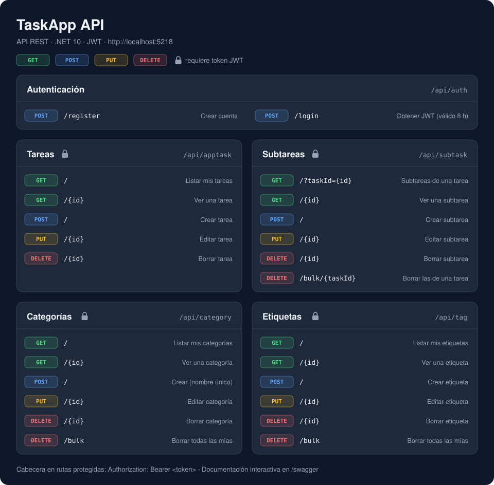

# TaskApp.Backend

API REST en .NET 10 para gestionar listas de tareas: cada usuario se registra, inicia sesión con JWT y organiza sus tareas en categorías, etiquetas y subtareas. Es el backend que consumirá el frontend de TaskApp.

> Proyecto en desarrollo, hecho durante las prácticas de DAM en Embrace-It. La API funciona de punta a punta, pero todavía puede cambiar.

## Qué hace

Cada usuario solo ve y modifica sus propios datos. La API lee el id de usuario del token (claim `sub`), así que el cliente no tiene que mandarlo en la URL ni en el cuerpo. Antes de llegar al controller, un middleware comprueba que la tarea pedida pertenece a quien la pide.

- Registro y login con ASP.NET Core Identity. El login devuelve un JWT válido durante 8 horas.
- CRUD de tareas, categorías, etiquetas y subtareas.
- Borrado masivo de categorías y etiquetas del usuario, y de las subtareas de una tarea.
- Validación de entrada con FluentValidation. No se permiten dos categorías con el mismo nombre para un mismo usuario.
- Errores no controlados devueltos como JSON con código 500, sin exponer la traza.
- Swagger con soporte para pegar el token y probar los endpoints protegidos.
- Tests unitarios con xUnit y Moq para controllers, servicios, repositorios, validadores y middlewares.

## Puesta en marcha

Necesitas:

- [.NET 10 SDK](https://dotnet.microsoft.com/download)
- PostgreSQL en local (o accesible desde tu máquina)
- La herramienta de migraciones de EF Core: `dotnet tool install --global dotnet-ef`

1. Clona el repositorio:

   ```bash
   git clone https://github.com/jpersan07/TaskApp.Backend.git
   cd TaskApp.Backend
   ```

2. Crea `TaskApp.API/appsettings.Development.json` con tu cadena de conexión y una clave para firmar los tokens. Este archivo está en el `.gitignore`, así que tus credenciales no se suben:

   ```json
   {
     "ConnectionStrings": {
       "DefaultConnection": "Host=localhost;Database=taskapp;Username=postgres;Password=tu_password"
     },
     "Jwt": {
       "Key": "una-clave-secreta-de-al-menos-32-caracteres"
     }
   }
   ```

   La clave tiene que tener 32 caracteres o más. Con menos, HMAC-SHA256 lanza una excepción al generar el token.

3. Crea la base de datos aplicando las migraciones:

   ```bash
   dotnet ef database update --project TaskApp.Infrastructure --startup-project TaskApp.API
   ```

4. Arranca la API:

   ```bash
   dotnet run --project TaskApp.API
   ```

   Queda escuchando en `http://localhost:5218`. Abre `http://localhost:5218/swagger` para ver todos los endpoints.

## Uso

Primero registra un usuario. Identity aplica sus reglas de contraseña por defecto: al menos 6 caracteres, con mayúscula, minúscula, número y un símbolo.

```bash
curl -X POST http://localhost:5218/api/auth/register \
  -H "Content-Type: application/json" \
  -d '{"email": "ana@example.com", "userName": "ana", "password": "Secreta1!"}'
```

Si va bien responde `200 OK` sin cuerpo. Si no, devuelve `400` con la lista de errores de Identity.

Después inicia sesión para obtener el token:

```bash
curl -X POST http://localhost:5218/api/auth/login \
  -H "Content-Type: application/json" \
  -d '{"userName": "ana", "password": "Secreta1!"}'
```

```json
{ "token": "eyJhbGciOiJIUzI1NiIsInR5cCI6IkpXVCJ9..." }
```

El resto de endpoints piden ese token en la cabecera `Authorization`:

```bash
curl -X POST http://localhost:5218/api/apptask \
  -H "Authorization: Bearer <token>" \
  -H "Content-Type: application/json" \
  -d '{"title": "Preparar la demo", "description": "Revisar endpoints", "dueDate": "2026-11-01T10:00:00Z"}'
```

En Swagger se hace lo mismo con el botón **Authorize**: pega el token y todas las peticiones lo llevarán.

### Endpoints



| Recurso | Ruta base | Operaciones |
|---|---|---|
| Autenticación | `/api/auth` | `POST register`, `POST login` |
| Tareas | `/api/apptask` | `GET`, `GET {id}`, `POST`, `PUT {id}`, `DELETE {id}` |
| Categorías | `/api/category` | `GET`, `GET {id}`, `POST`, `PUT {id}`, `DELETE {id}`, `DELETE bulk` |
| Etiquetas | `/api/tag` | `GET`, `GET {id}`, `POST`, `PUT {id}`, `DELETE {id}`, `DELETE bulk` |
| Subtareas | `/api/subtask` | `GET ?taskId=`, `GET {id}`, `POST`, `PUT {id}`, `DELETE {id}`, `DELETE bulk/{taskId}` |

Una tarea tiene título, descripción, fecha límite, categoría opcional y un estado: `NonStarted`, `InProgress`, `Paused`, `Late` o `Finished`.

## Estructura

El código sigue Clean Architecture: cuatro capas y un proyecto aparte para los tests.

```
TaskApp.Domain          Entidades y enums, sin dependencias de infraestructura
TaskApp.Application     Servicios, DTOs, validadores e interfaces de repositorio
TaskApp.Infrastructure  DbContext, migraciones, repositorios y AuthService (Identity + JWT)
TaskApp.API             Controllers, middlewares y configuración (Program.cs)
TaskApp.Tests           Tests unitarios
```

En [PROYECTO.md](PROYECTO.md) está explicado con más calma cómo encajan repositorios, servicios, DTOs y controllers, y el recorrido completo de una petición.

## Tests

```bash
dotnet test TaskApp.Tests
```

Los repositorios se prueban contra la base de datos en memoria de EF Core, así que no hace falta tener PostgreSQL levantado. Para generar el informe de cobertura:

```bash
dotnet test TaskApp.Tests --collect:"XPlat Code Coverage"
```

## Contribuir

El trabajo se organiza con Git Flow:

- `main` guarda la versión estable y `develop` es la rama de integración.
- Cada tarea va en su propia rama (`feature/...`, `fix/...`, `refactor/...`) creada desde `develop`.
- Los cambios entran por pull request a `develop`, nunca con merge local.
- Los commits siguen [Conventional Commits](https://www.conventionalcommits.org/es/): `feat:`, `fix:`, `refactor:`, `chore:`, `test:`.

Antes de abrir una PR, comprueba que `dotnet test TaskApp.Tests` pasa.

## Licencia

Todavía no tiene licencia. Mientras no se añada un archivo `LICENSE`, el código no se puede reutilizar fuera del proyecto sin permiso del autor.
